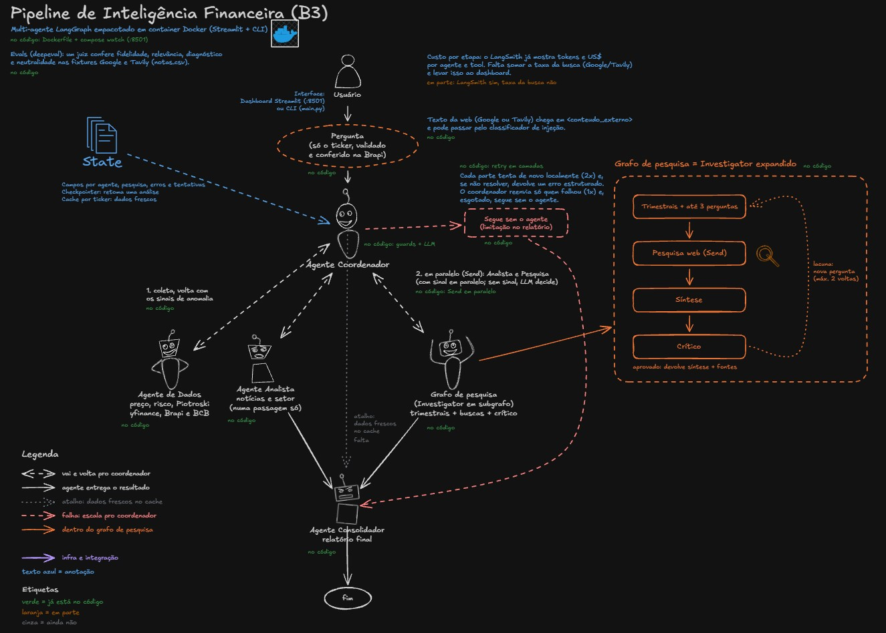
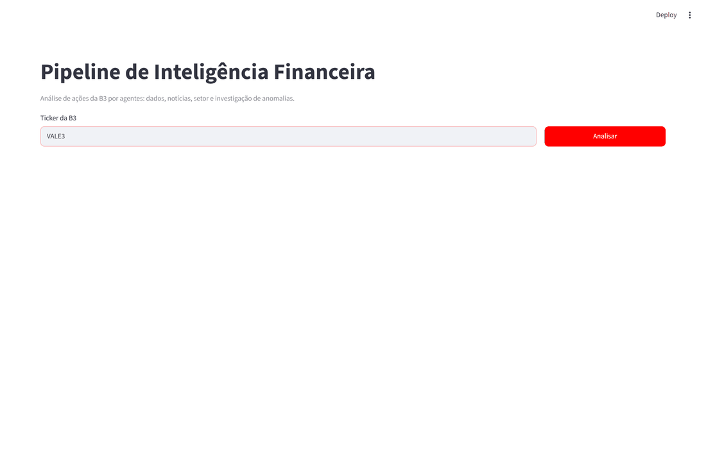
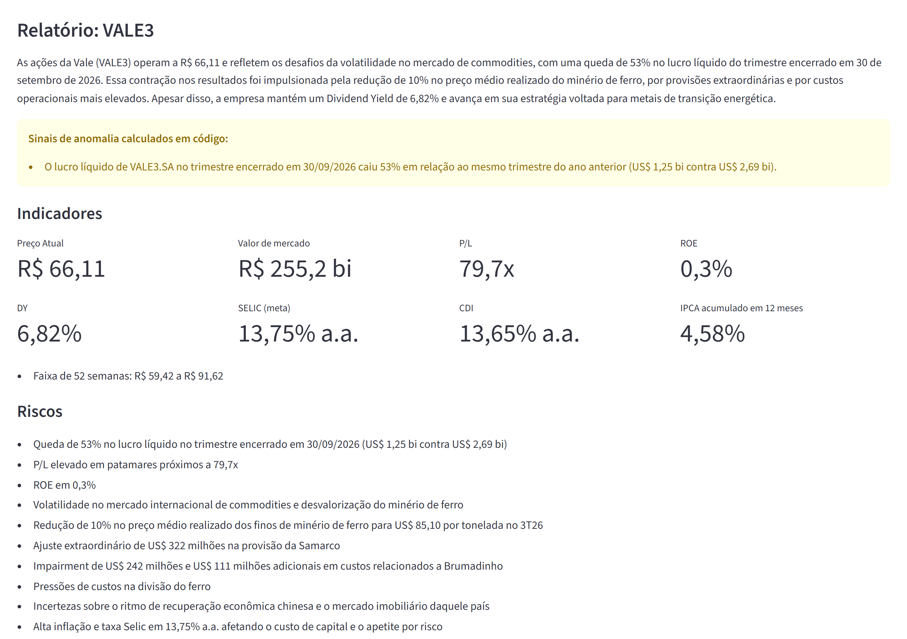
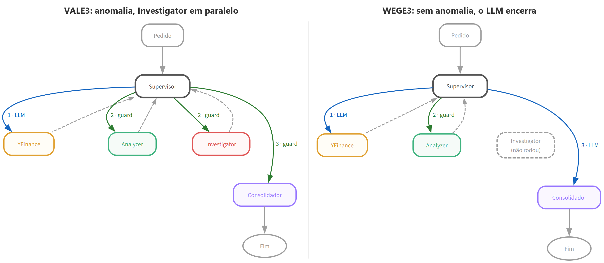
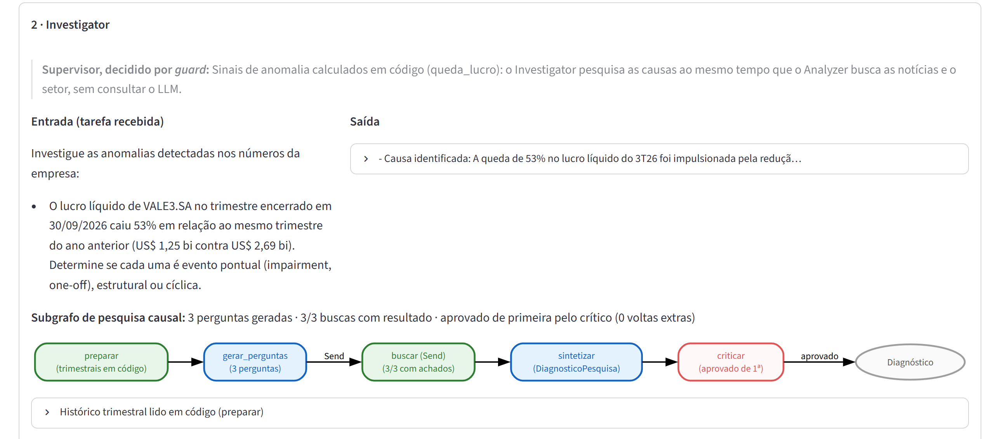
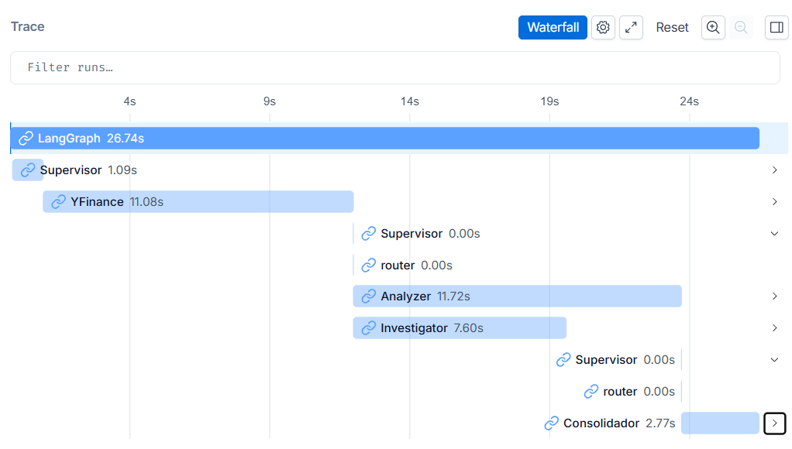

# Pipeline de Inteligência Financeira (B3)

Você digita o código de uma ação da B3 e um grupo de agentes coordenado com LangGraph monta um relatório: preço, múltiplos, risco, notícias, contexto do setor e, quando o lucro despenca, uma investigação do porquê. O LLM é o Gemini 3.5 Flash-Lite, e os dados vêm da Brapi, do yfinance, do Banco Central e de buscas na web.

<p align="center">
  
</p>

O desenho é a arquitetura-alvo: verde é o que já está no código, laranja está em parte e cinza ainda não existe. As decisões por trás de cada peça estão em [`docs/decisoes.md`](docs/decisoes.md), e as quatro partes que o desenho não explica por dentro (guards, subgrafo de pesquisa, retry e evals) estão em [`docs/arquitetura.md`](docs/arquitetura.md).

<p align="center">
  
</p>

## O que ele faz

Um **Supervisor** decide quem trabalha, mas só chama o LLM quando a decisão pede julgamento. As transições óbvias (dados coletados, então buscar notícias, por exemplo) são regras em código e não gastam token.

- **YFinance** coleta cotação, setor e os maiores do setor pela Brapi e P/L, ROE, DY, risco (Sharpe, Sortino, drawdown, VaR, beta, alpha) e Piotroski pelo yfinance. Em código, sem passar pelo LLM, a resposta dele ganha SELIC, CDI e IPCA de 12 meses do Banco Central e os sinais de anomalia: lucro mais de 30% abaixo do mesmo trimestre do ano anterior, prejuízo ou Piotroski de 3 ou menos.
- **Analyzer** busca notícias da empresa e do setor numa passagem só, pelo Google Search (via Gemini) ou pela Tavily, com a NewsAPI de reserva.
- **Investigator** só roda quando há anomalia. É um subgrafo com caminho fixo: lê o histórico trimestral, escreve até 3 perguntas sobre a causa, busca as respostas em paralelo e passa o diagnóstico por um crítico, que pode pedir até 2 rodadas de busca a mais.
- **Consolidador** fecha toda análise com um relatório (resumo, indicadores, riscos, limitações e o diagnóstico) e não recomenda compra nem venda.

```
Usuário → Supervisor → YFinance → Supervisor → Analyzer
                                               [+ Investigator em paralelo, se há sinal de anomalia]
        → Supervisor → Consolidador → relatório
```

Na VALE3, que teve queda de lucro, o Analyzer e o Investigator rodam ao mesmo tempo. Na WEGE3, sem sinal, o Analyzer roda sozinho e o LLM decide encerrar. As duas análises fecham em 3 passagens do Supervisor e levam de 20 a 30 segundos.

## Demonstração

O relatório da VALE3: o sinal de anomalia que o código achou, os indicadores da empresa e da economia e, logo abaixo, os riscos.

<p align="center">
  
</p>

O caminho de cada análise, com o número da ordem e quem decidiu cada passo (guard é regra em código, LLM é o modelo). Na VALE3, o mesmo passo 2 manda o Analyzer e o Investigator ao mesmo tempo. Na WEGE3, o Investigator nem roda.

<p align="center">
  
</p>

O card do Investigator mostra a tarefa que ele recebeu do Supervisor, o começo do diagnóstico e o subgrafo de pesquisa que rodou dentro dele: 3 perguntas, 3 buscas com resultado e o crítico aprovando de primeira.

<p align="center">
  
</p>

No LangSmith, as passagens do Supervisor decididas pelos guards levam 0,00 s e não chamam o LLM, e o Analyzer e o Investigator começam no mesmo instante.

<p align="center">
  
</p>

## Como rodar

```bash
uv sync
cp .env.example .env    # e preencha pelo menos GEMINI_API_KEY e NEWS_API_KEY
make streamlit          # dashboard em http://localhost:8501
```

Sem o `make` (no Windows, ele se instala com `winget install ezwinports.make`):

```bash
uv run streamlit run dashboard/app.py   # dashboard
uv run python main.py                   # versão de terminal, pede o ticker
```

O dashboard tem três abas: **Relatório**, **Como foi feito** (o caminho que a análise percorreu, quem decidiu cada passo e o que cada agente recebeu e devolveu) e **State (JSON)**. Cada análise gasta créditos de verdade (uns centavos de dólar), por isso só o botão **Analisar** roda o grafo.

Pelo código:

```python
from langchain_core.messages import HumanMessage
from fluxo_financeiro import app

resultado = app.invoke({"messages": [HumanMessage("Analise WEGE3")]})
print(resultado["messages"][-1].content)
```

### Com Docker

Só o dashboard roda no container. A CLI, os testes e os evals continuam fora dele, pelo `uv`.

```bash
cp .env.example .env    # o mesmo .env: lido na hora de subir, nunca copiado para a imagem
make docker-up          # docker compose up --build -d, dashboard em http://localhost:8501
make docker-dev         # docker compose up --build --watch, recarrega ao salvar
make docker-down        # para e remove o container
```

No `make docker-dev`, salvar um arquivo em `fluxo_financeiro/` ou `dashboard/` copia o arquivo para o container e a página recarrega em segundos, sem rebuild. Mexer no `pyproject.toml` ou no `uv.lock` refaz a imagem, mas o `uv sync` só reinstala o que mudou, porque as dependências ficam numa camada própria, antes do código, e os pacotes baixados ficam num cache do build. A imagem tem dois estágios (o `uv` monta o `.venv` e só o `.venv` e o código vão para a imagem final), deixa de fora os grupos `dev` e `notebooks`, roda com um usuário sem privilégio e tem healthcheck. O `.dockerignore` é uma lista de permissão: só `pyproject.toml`, `uv.lock`, `fluxo_financeiro/` e `dashboard/` entram no contexto do build.

## Chaves de API

| Variável | Onde conseguir | Precisa? |
|---|---|---|
| `GEMINI_API_KEY` | [Google AI Studio](https://aistudio.google.com/apikey), em **Create API key** | Sim: é o LLM de todos os agentes e a busca no Google |
| `NEWS_API_KEY` | [newsapi.org/register](https://newsapi.org/register), plano gratuito | Sim: é a reserva quando a busca na web falha |
| `BRAPI_API_KEY` | [brapi.dev](https://brapi.dev), token no [painel](https://brapi.dev/dashboard), plano gratuito | Recomendada: confere se o ticker existe antes de gastar uma análise e traz cotação, setor da B3 e os maiores do setor. Sem ela, tudo vem do yfinance e o relatório avisa |
| `TAVILY_API_KEY` | [app.tavily.com](https://app.tavily.com), em **API Keys** (1.000 buscas grátis por mês) | Só com `BUSCA_PROVEDOR=tavily` |
| `LANGSMITH_API_KEY` | [smith.langchain.com](https://smith.langchain.com), em **Settings → API Keys** | Não: só para ver os traces |

O Banco Central não pede chave. A busca no Google pelo Gemini só funciona com faturamento ativo no projeto da chave (crédito pré-pago no AI Studio serve, o crédito de boas-vindas do Google Cloud não). Sem faturamento, `BUSCA_PROVEDOR=tavily` manda todas as buscas para a Tavily e o Gemini fica só como LLM.

## Segurança das entradas

- **Ticker:** a CLI e o dashboard só aceitam o código inteiro (`VALE3`, `TAEE11`, com ou sem `.SA`). Um código no formato certo que a Brapi não conhece também é recusado, com sugestão quando ela acha uma: `WEGE4` vira "Você quis dizer WEGE3?".
- **Texto de fora:** o que vem das buscas, da NewsAPI e da descrição da empresa chega aos agentes dentro de `<conteudo_externo>`, com `<` e `>` escapados, e todo prompt diz que esse conteúdo é dado e nunca instrução.
- **Checagem por IA** (`SANITIZACAO_ATIVA=true`, desligada por padrão): antes de chegar aos agentes, cada resultado de busca passa por um classificador que procura ordens dirigidas ao sistema. Se acha, troca o texto por um aviso, que entra nas limitações do relatório. Custa uma chamada a mais por busca.

## Testes

```bash
make test    # 390 testes, tudo mockado, ~23 s
```

A rede fica bloqueada nos testes pelo `pytest-socket`: um mock esquecido reprova o teste em vez de chamar uma API paga. A suíte já teve 564 testes e foi enxugada: saiu o que não protegia nenhuma regra (teste de código morto, a mesma regra testada em três camadas, variações de formatação).

O e2e roda o grafo de verdade e falha se o caminho sair do esperado:

```bash
make e2e-anomalia    # VALE3: falha se o Investigator NÃO rodar
make e2e-estavel     # WEGE3: falha se o Investigator rodar
BUSCA_PROVEDOR=tavily uv run python scripts/e2e.py VALE3 --espera-investigator
```

Os evals medem o texto. Um juiz (`gemini-3.8-flash`, pela `deepeval`) lê a resposta de cada agente contra o que aquele agente tinha em mãos e mede fidelidade, a qualidade do diagnóstico, relevância, cobertura e neutralidade (nenhuma recomendação de compra ou venda). Ficam fora do `pytest` comum porque custam dinheiro:

```bash
make eval-fixtures        # grava uma análise real da VALE3 e da WEGE3
make eval FIXTURE=vale3   # roda os evals numa fixture 
make -k eval-todos        # as duas fixtures
```

Toda nota vai para `tests/evals/notas.csv`, com o custo, e cada reprovação deixa os vereditos do juiz em `tests/evals/_falhas/`.

## Limitações conhecidas

- As regras de anomalia foram calibradas olhando poucos tickers, basicamente VALE3 e WEGE3. Os limites são constantes em `fluxo_financeiro/tools/anomalias.py`.
- No plano gratuito da Brapi, demonstrativos e indicadores voltam com 403 (só PETR4, VALE3, MGLU3 e ITUB4, os tickers de teste, trazem tudo). Por isso trimestrais, Piotroski e risco vêm do yfinance.
- O yfinance demora a publicar os trimestres e às vezes se contradiz: em 09/11/2026, o ROE da VALE3 vinha como 0,3%, enquanto o P/L e o P/VP dele mesmo davam algo perto de 1,8%.
- O agente YFinance escolhe as tools pelo texto do pedido. Com "Analise a ação X", às vezes chama só a de preço e múltiplos, e o relatório sai sem risco e sem Piotroski.
- O classificador da sanitização também é um LLM e erra para os dois lados.

## Próximos passos

- Deploy na AWS em cima do container
- Banco de dados para registrar cada análise (entrada, saída, data e hora)
- Checkpointer para retomar uma análise e cache para não buscar de novo um dado que acabou de chegar
- LiteLLM na frente do modelo, para trocar de provedor sem mexer nos agentes
- Servidor MCP com as tools do projeto (dados da ação, métricas de risco, Piotroski, indicadores do BCB, notícias e histórico trimestral), para outros clientes e agentes usarem as mesmas ferramentas sem passar pelo grafo
- Expor o pipeline como agente A2A, para um futuro fluxo de análise de carteira descobrir e chamar

## Estrutura

```
fluxo_financeiro/
├── shared/    # config, fábrica do LLM, tipos, prompts, retry, utilitários
├── tools/     # dados de mercado, notícias, busca na web, anomalias, sanitização, Brapi
├── agents/    # YFinance, Analyzer, subgrafo de pesquisa do Investigator, Consolidador
└── graph/     # Supervisor (guards e LLM) e o StateGraph
dashboard/     # Streamlit e as funções que transformam o state em tela
scripts/       # e2e e gerador das fixtures dos evals
tests/         # espelha fluxo_financeiro/, mais os evals
notebooks/     # fluxo_financeiro/01 a 20: cada peça explicada e rodando com as APIs reais
docs/          # arquitetura.md, decisoes.md e o desenho
```

## Stack

| Camada | Tecnologia |
|---|---|
| Orquestração | LangGraph 1.x |
| LLM | Gemini 3.5 Flash-Lite (`langchain-google-genai`) |
| Dados | Brapi, yfinance e API SGS do Banco Central |
| Busca e notícias | Google Search pelo Gemini ou Tavily, NewsAPI de reserva |
| Dashboard | Streamlit, com o caminho da análise em graphviz |
| Observabilidade | LangSmith |
| Testes | pytest, pytest-socket e deepeval |
| Ambiente | uv, Docker e docker compose (dashboard) |
