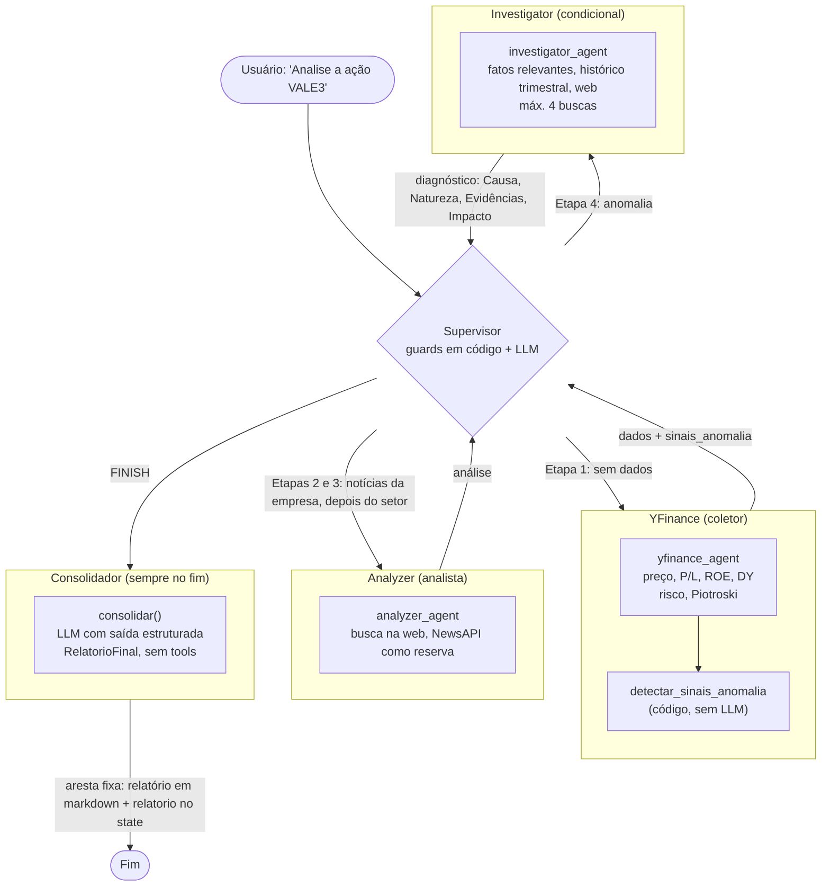
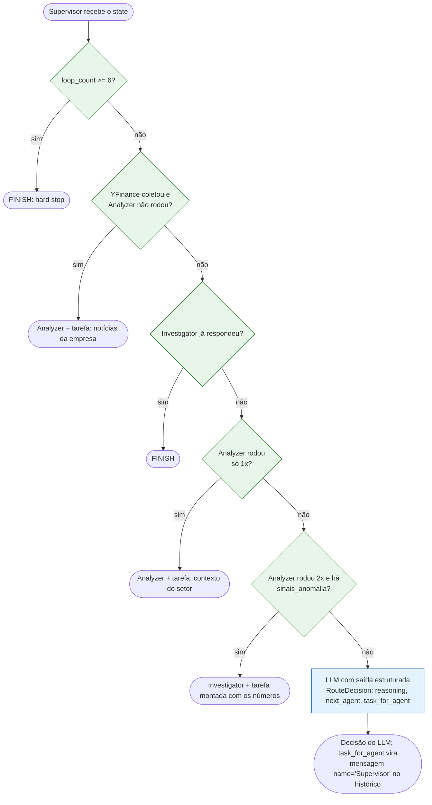
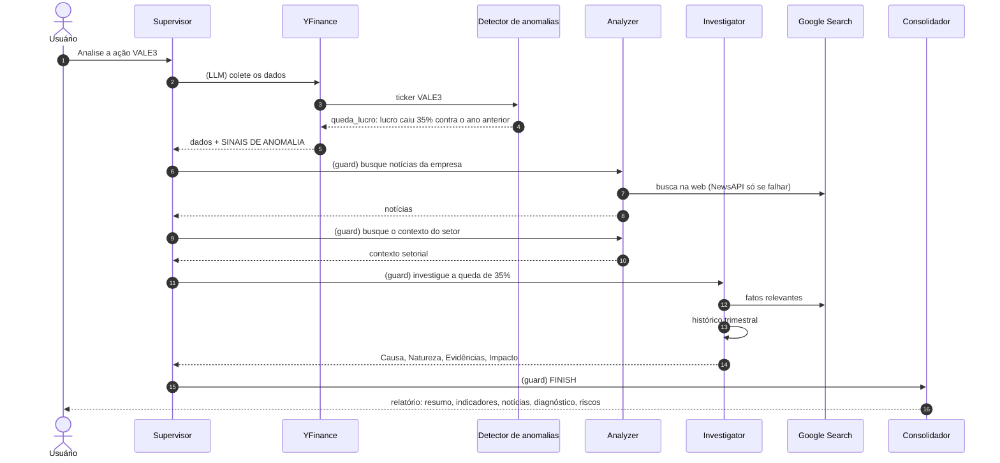
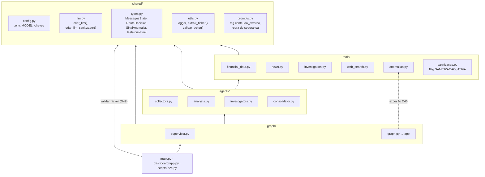
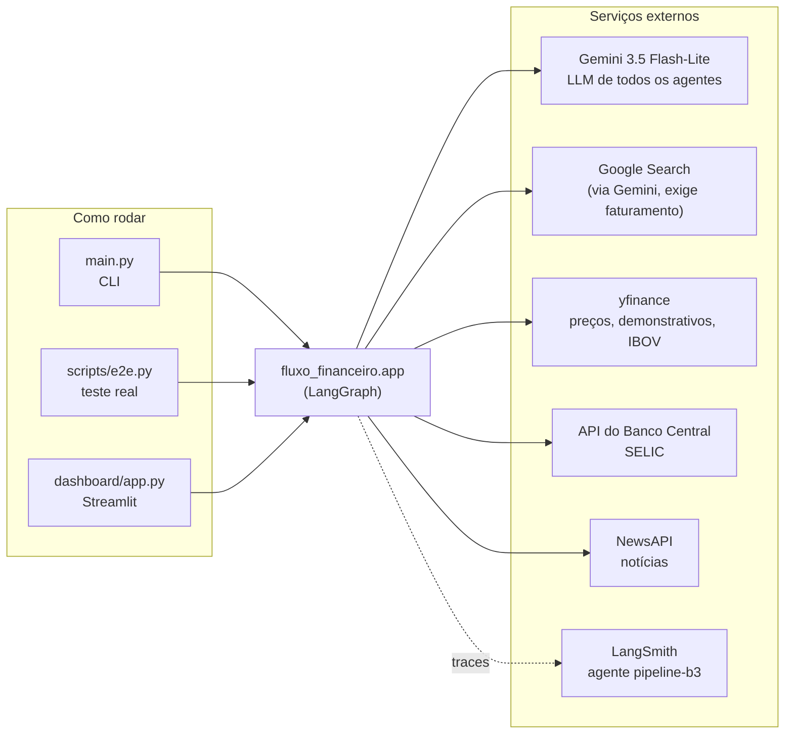

# Arquitetura

Desenho do sistema como ele está hoje. O **porquê** de cada escolha está em [`decisoes.md`](decisoes.md) (as referências `Dxx` abaixo apontam para lá).

Os diagramas são [Mermaid](https://mermaid.js.org/): o GitHub e o VS Code (com a extensão *Markdown Preview Mermaid Support*) desenham direto do texto. Ao mudar a arquitetura, atualize o diagrama no mesmo commit.

---

## 1. Fluxo do grafo

Um **Supervisor** decide quem trabalha; três **workers** executam e sempre devolvem o controle a ele. Só o Supervisor encerra, e todo encerramento (inclusive o hard stop) passa pelo **Consolidador**, que monta o relatório final (D41).

| Etapa | Condição | Vai para | Quem decide |
|---|---|---|---|
| 1 | Ainda não há dados do YFinance | YFinance | LLM |
| 2 | YFinance coletou, Analyzer ainda não rodou | Analyzer (notícias da empresa) | Guard |
| 3 | Uma passagem do Analyzer | Analyzer (contexto do setor) | Guard (D45) |
| 4 | Duas passagens do Analyzer **e** sinais de anomalia | Investigator | Guard (D40) |
| 4 | Duas passagens do Analyzer, **sem** sinais | Investigator ou FINISH | LLM (D25) |
| — | Investigator já respondeu | FINISH | Guard (D28) |
| — | `loop_count >= 6` | FINISH | Hard stop (D21) |
| — | Qualquer FINISH | Consolidador → fim | Router: FINISH sempre vai ao Consolidador (D41) |

---

## 2. Como o Supervisor decide

A ordem importa: as regras em código vêm antes e, quando uma delas resolve, o LLM nem é chamado. No trace do LangSmith essas passagens aparecem com **0 tokens** (D36).

Sinais calculados em código (`tools/anomalias.py`, D40):

| Sinal | Regra |
|---|---|
| `queda_lucro` | Lucro líquido do último trimestre mais de 30% abaixo do **mesmo trimestre do ano anterior** |
| `prejuizo` | Lucro líquido do último trimestre negativo |
| `piotroski_fraco` | Piotroski F-Score ≤ 3 |

Dado faltando no yfinance → a regra é pulada, nunca acusa.

---

## 3. Uma análise com anomalia, passo a passo

Exemplo real (VALE3, 02/11/2026): ~25 s, ~30 mil tokens, ~US$ 0,016 antes do Consolidador, que acrescenta uma chamada ao LLM.

---

## 4. Camadas do código

A dependência flui num único sentido (D03): nenhuma camada importa de uma camada acima dela. A seta tracejada é a única exceção, e ela ainda aponta para baixo: o grafo chama o detector de anomalias direto, porque é cálculo e não agente (D40).

---

## 5. Serviços externos e interfaces

---

## 6. Estado (`MessagesState`)

| Campo | Como acumula | Para que serve |
|---|---|---|
| `messages` | `add_messages` (concatena) | Histórico inteiro. Mensagens de agentes são `HumanMessage` com `name` = quem falou (`YFinance`, `Analyzer`, `Investigator`, `Supervisor`) |
| `next_agent` | Sobrescreve | Decisão do Supervisor: `YFinance`, `Analyzer`, `Investigator` ou `FINISH` (o router troca FINISH pelo Consolidador) |
| `loop_count` | `operator.add` (soma) | Cada passagem do Supervisor soma 1; hard stop em 6 |
| `supervisor_reasoning` | Sobrescreve | Justificativa da última decisão (vai para o dashboard) |
| `decidido_por` | Sobrescreve | Quem decidiu a última passagem do Supervisor: `guard`, `llm` ou `hard_stop` (o dashboard desenha nas setas, D46) |
| `sinais_anomalia` | Sobrescreve | Sinais calculados em código pelo nó do YFinance; alimentam o guard da Etapa 4 |
| `relatorio` | Sobrescreve | `RelatorioFinal` do Consolidador (resumo, indicadores, contexto, riscos, limitações, diagnóstico copiado do Investigator); `None` se o LLM dele falhou (D42) |

---

## 7. O que ainda não existe

Próximos passos (ver "Próximas decisões em aberto" em [`decisoes.md`](decisoes.md)):

- **Estado estruturado completo**: `sinais_anomalia` e `relatorio` são os campos além das mensagens (D42); dados, notícias e diagnóstico ainda trafegam como texto entre os agentes, e o Supervisor lê o histórico.
- **Human-in-the-loop, checkpointer e cache de dados**: vindos do desenho de evolução no Excalidraw.
