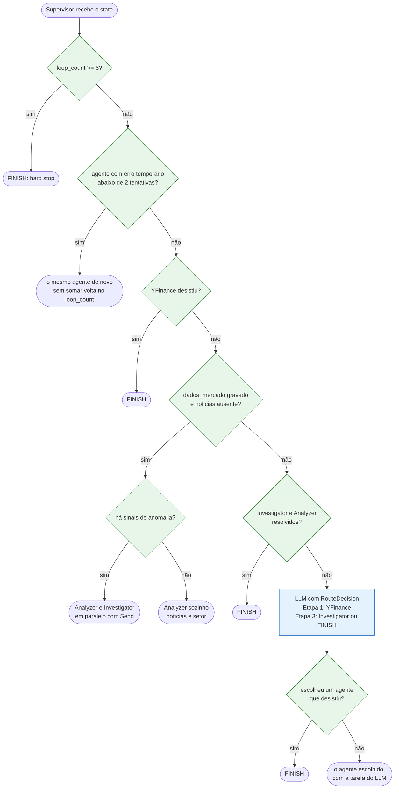
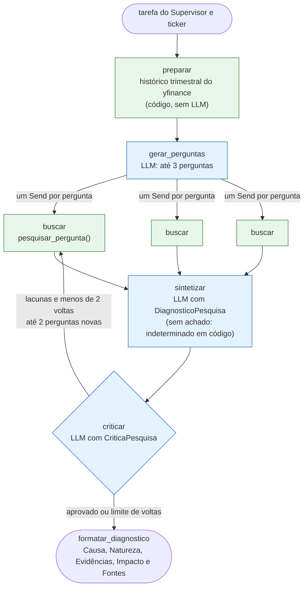
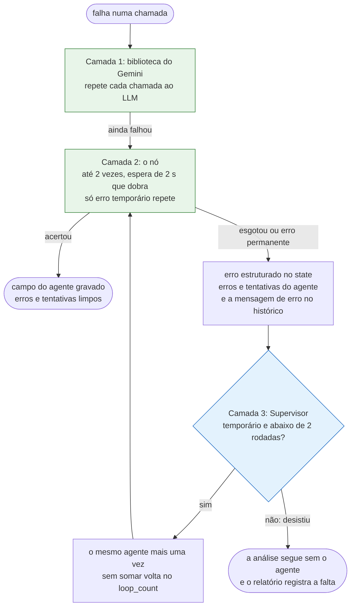
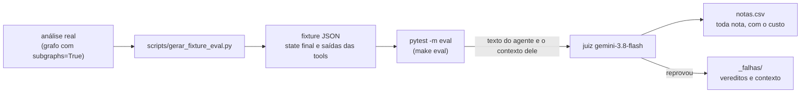

# Arquitetura

O desenho geral está em [`desenho-arquitetura.jpg`](desenho-arquitetura.jpg) e a história de cada escolha está em [`decisoes.md`](decisoes.md). Aqui ficam as quatro peças que o desenho mostra por fora mas não explica por dentro: como o Supervisor decide, como o Investigator pesquisa, o que acontece quando algo falha e como a qualidade do texto é medida.

## 1. Como o Supervisor decide

Antes de chamar o LLM, o Supervisor passa por uma sequência de regras em código (os guards). Quando uma delas resolve, o LLM nem é chamado, e a passagem aparece no trace do LangSmith com 0 tokens. Numa análise da VALE3, duas das três passagens são decididas assim: o despacho do Analyzer com o Investigator em paralelo e o encerramento. O LLM fica com o que pede julgamento, como decidir se uma empresa sem sinal numérico ainda merece investigação.

O pipeline tem três etapas:

- **Etapa 1:** o YFinance coleta preço, múltiplos, risco e Piotroski. Em código, o nó dele calcula os sinais de anomalia (lucro mais de 30% abaixo do mesmo trimestre do ano anterior, prejuízo, Piotroski de 3 ou menos) e anexa SELIC, CDI e IPCA de 12 meses do Banco Central.
- **Etapa 2:** o Analyzer busca notícias da empresa e do setor numa passagem só. Se a Etapa 1 achou sinal, o guard manda o Investigator junto, no mesmo passo do LangGraph, com `Send`.
- **Etapa 3:** sem sinal em código, o LLM lê tudo e responde a uma pergunta: um investidor ficaria com dúvida de por que esse número aconteceu? Se sim, chama o Investigator. Se não, encerra.

Todo encerramento, inclusive o hard stop de 6 passagens, passa pelo Consolidador, que escreve o relatório final.

Os guards leem os campos que cada agente grava no state (`dados_mercado`, `noticias`, `contexto_setor`, `diagnostico`) e não contam mensagens no histórico. Com o paralelo, a ordem das mensagens muda de uma execução para outra, e um campo presente diz sem ambiguidade que a etapa rodou.

## 2. O subgrafo de pesquisa do Investigator

O Investigator começou como um agente com tools, que decidia sozinho quantas buscas fazer e em que ordem. Ele virou um subgrafo com o caminho fixo em código (`agents/pesquisa.py`), e o LLM entra só nos três pontos em que precisa escrever:

- `preparar` lê o histórico trimestral do yfinance, sem LLM e sem busca.
- `gerar_perguntas` escreve até 3 perguntas sobre a causa da anomalia.
- `buscar` faz uma busca na web por pergunta, todas em paralelo com `Send`. O texto volta dentro de `<conteudo_externo>`, e uma busca que falha só deixa a pergunta sem achado.
- `sintetizar` escreve o diagnóstico (causa, natureza, evidências, impacto). Se nenhuma busca trouxe nada, o código devolve natureza `indeterminado` sem chamar o LLM, para ele não inventar uma causa.
- `criticar` aprova ou devolve lacunas. Cada volta traz no máximo 2 perguntas novas, com no máximo 2 voltas, então o pior caso são 7 buscas.

As quatro linhas do diagnóstico saem de `formatar_diagnostico`, em código, e o Consolidador as copia literalmente para o relatório. Por isso o formato não depende de o LLM lembrar dos títulos.

## 3. Retry em camadas

Uma falha em qualquer agente não derruba a análise. A regra é que quem está mais perto da falha tenta de novo primeiro, e só o que não se resolve ali sobe para o Supervisor:

- **Camada 1:** a biblioteca do Gemini repete sozinha cada chamada ao LLM.
- **Camada 2:** o nó roda o agente até 2 vezes, com espera de 2 s que dobra, e só repete erro temporário (timeout, conexão, 429 por minuto, 5xx). As chamadas que o próprio código faz (Banco Central, Brapi, buscas do subgrafo) passam pela mesma regra em `com_retentativas`.
- **Camada 3:** se o nó esgotou e o erro era temporário, o Supervisor manda o mesmo agente mais uma vez, sem somar volta no `loop_count`. Se o erro é permanente (chave errada, cota zerada) ou o agente já falhou duas rodadas, a análise segue sem ele, e o Consolidador põe a falta nas limitações do relatório.

O reenvio não conta volta porque a análise com Investigator já usa 3 das 6 passagens do hard stop, e uma falha comum o levaria ao limite. Quem garante que o reenvio termina é o limite por agente. A `RetryPolicy` do LangGraph ficou de fora porque ela só enxerga a exceção que escapa do nó, e aqui o nó transforma a exceção em erro estruturado para o Supervisor decidir.

## 4. Como a qualidade é medida

São três níveis de teste, cada um respondendo a uma pergunta diferente.

Os testes unitários (`make test`) conferem o código com tudo mockado, e a rede fica bloqueada pelo `pytest-socket`. Um mock esquecido reprova o teste em vez de chamar uma API paga.

O e2e (`make e2e-anomalia` e `make e2e-estavel`) roda o grafo de verdade e falha se o caminho sair do esperado: a VALE3 tem de acionar o Investigator em paralelo, e a WEGE3 tem de terminar sem ele. Na última rodada, as duas fecharam em 3 passagens do Supervisor, com 21,5 s e 26,0 s.

Os evals conferem o texto. Uma análise real é gravada uma vez como fixture, e um LLM-juiz diferente do modelo dos agentes (`gemini-3.8-flash`) lê a resposta de cada agente contra o que aquele agente tinha em mãos.

| Agente | O que o juiz mede |
|---|---|
| Analyzer | Fidelidade às buscas |
| Investigator | Fidelidade ao que o subgrafo leu e qualidade do diagnóstico (GEval) |
| Consolidador | Fidelidade aos insumos, relevância e cobertura (a cobertura registra a nota mas não reprova) |
| Relatório final | Neutralidade: nenhuma recomendação de compra ou venda |

Na fidelidade da `deepeval`, só a afirmação que a fonte contradiz derruba a nota, e a que a fonte não menciona passa. Por isso cada fidelidade grava no `notas.csv` uma segunda nota, a rígida, que conta só as afirmações que a fonte confirma. Ela sai dos vereditos que o juiz já devolveu, não custa chamada nova e nunca reprova. Uma rodada completa nas fixtures da VALE3 e da WEGE3 custa entre US\$ 0,19 e US\$ 0,24 de juiz.
