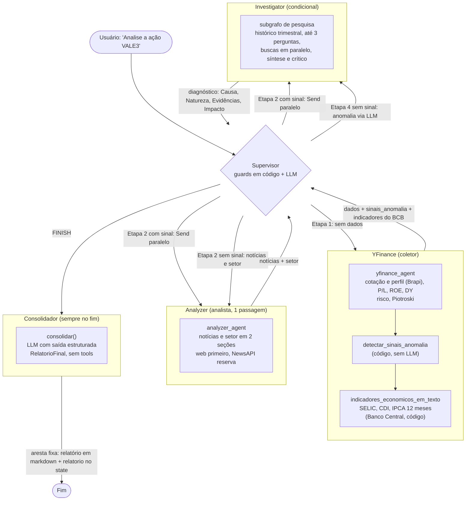
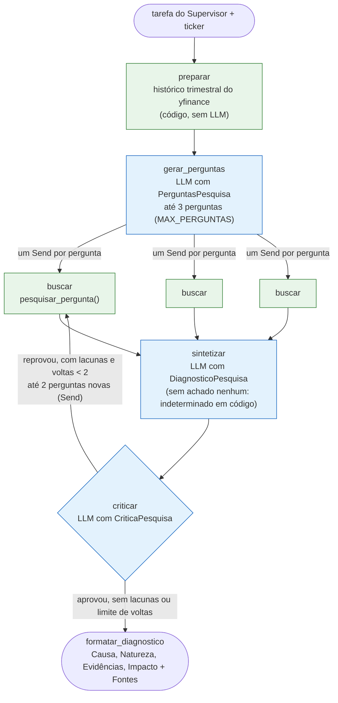
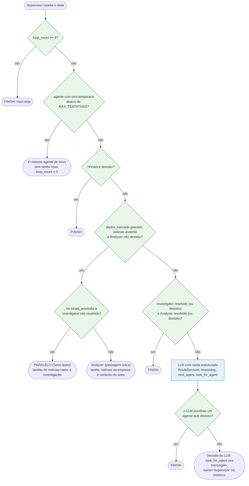
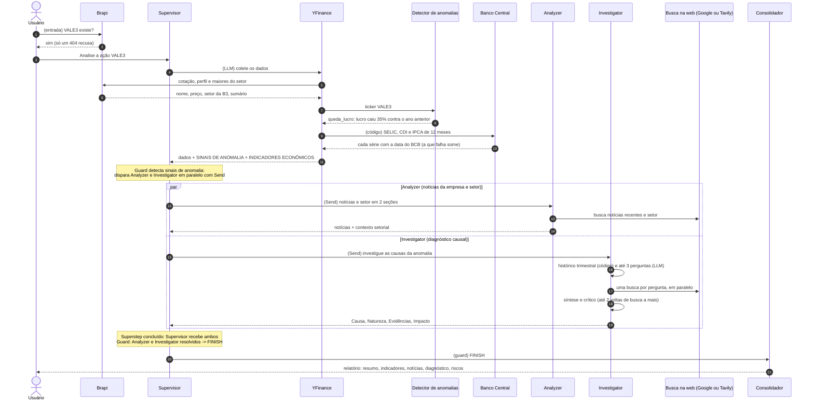
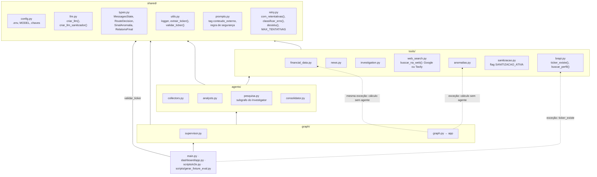
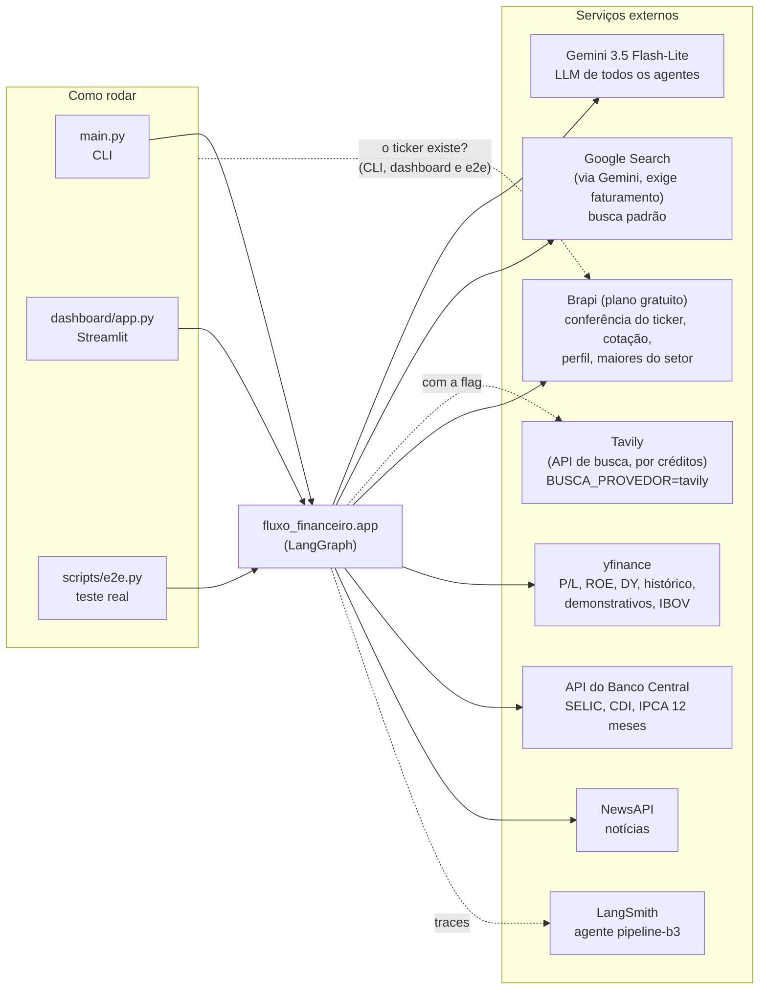
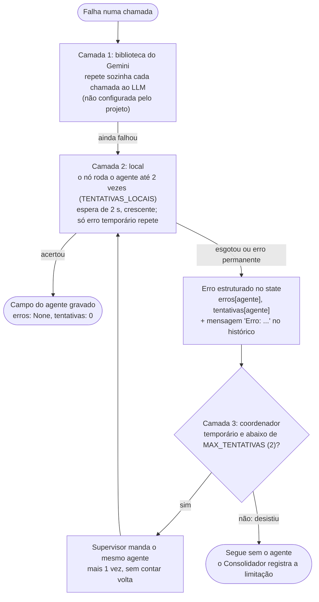
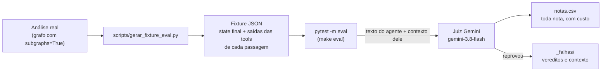

# Arquitetura

Desenho do sistema como ele está hoje. A história de por que ele ficou assim está em [`decisoes.md`](decisoes.md).

Os diagramas são [Mermaid](https://mermaid.js.org/): o GitHub e o VS Code (com a extensão *Markdown Preview Mermaid Support*) desenham direto do texto. Ao mudar a arquitetura, atualize o diagrama no mesmo commit.

---

## 1. Fluxo do grafo

Um **Supervisor** decide quem trabalha; três **workers** executam e sempre devolvem o controle a ele. Só o Supervisor encerra, e todo encerramento (inclusive o hard stop) passa pelo **Consolidador**, que monta o relatório final.

| Etapa | Condição | Vai para | Quem decide |
|---|---|---|---|
| 1 | Ainda não há `dados_mercado` | YFinance | LLM |
| 2 (com sinal) | `dados_mercado` gravado, `noticias` não, Analyzer não desistiu **e** há `sinais_anomalia` | Analyzer e Investigator em paralelo (`Send`) | Guard |
| 2 (sem sinal) | `dados_mercado` gravado, `noticias` não, Analyzer não desistiu, **sem** sinais | Analyzer (notícias e setor numa passagem só) | Guard |
| 3 | Não existe mais como etapa separada (setor vem na resposta única do Analyzer) | — | — |
| 4 | Analyzer resolvido (notícias e setor gravados, ou desistiu), **sem** sinais prévios | Investigator ou FINISH (agente que desistiu escolhido pelo LLM vira FINISH) | LLM |
| retry | Agente com erro temporário abaixo do limite (seção 7) | O mesmo agente, sem tarefa nova e sem contar volta | Guard |
| fim | YFinance desistiu | FINISH | Guard |
| fim | Investigator resolvido (`diagnostico` gravado ou desistiu) **e** Analyzer resolvido | FINISH | Guard |
| fim | `loop_count >= 6` | FINISH | Hard stop |
| fim | Qualquer FINISH | Consolidador → fim | Router: FINISH sempre vai ao Consolidador |

### Dentro do Investigator: o subgrafo de pesquisa

O Investigator não é um agente com tools: é um subgrafo (`agents/pesquisa.py`) com o caminho fixo em código. O nó `Investigator` do grafo principal chama `investigar(tarefa, ticker)` dentro do `_rodar_com_retry` e devolve o diagnóstico (`diagnostico`) e o registro da pesquisa (`pesquisa`).

| Peça | O que faz | Limite ou falha |
|---|---|---|
| `preparar` | `buscar_historico_trimestral` em código | Erro vira o texto de erro da tool, e a pesquisa segue |
| `gerar_perguntas` | Perguntas causais sobre a anomalia | Corta em `MAX_PERGUNTAS` (3) |
| `buscar` | Uma busca na web por pergunta (`pesquisar_pergunta`, com `com_retentativas`), texto em `<conteudo_externo>` | Falha ou vazio vira achado vazio; as outras perguntas seguem |
| `sintetizar` | Diagnóstico com saída estruturada: natureza é `pontual`, `estrutural`, `cíclico` ou `indeterminado` | Sem nenhum achado, não chama o LLM e devolve `indeterminado` |
| `criticar` | Aprova ou devolve lacunas (perguntas novas) | Até `MAX_LACUNAS` (2) por volta e `MAX_VOLTAS` (2) voltas: no pior caso, 7 buscas. Depois do limite encerra sem chamar o LLM |

Os três prompts (`PERGUNTAS_PROMPT`, `SINTESE_PROMPT`, `CRITICO_PROMPT`) seguem o padrão XML dos outros e terminam com `REGRA_CONTEUDO_EXTERNO`. Os dados vão na mensagem humana em tags, escapados: `<tarefa_supervisor>`, `<historico_trimestral>`, `<achados>` (um `<achado pergunta="..." rodada="...">` por busca) e, para o crítico, `<diagnostico_rascunho>`.

Uma exceção do LLM dentro do subgrafo sobe para o nó, e o retry dele roda o subgrafo inteiro de novo. A saída estruturada vazia ou com JSON quebrado vira `RespostaVazia` (temporária) em `chamar_estruturado`, para cair no mesmo retry. As fontes do diagnóstico vêm só da última linha `Fontes:` de cada achado, para nenhuma linha do texto da web sair da tag.

---

## 2. Como o Supervisor decide

A ordem importa: as regras em código vêm antes e, quando uma delas resolve, o LLM nem é chamado. No trace do LangSmith essas passagens aparecem com **0 tokens**.

Os guards leem os campos que cada agente grava no state (seção 6), não contam mensagens pelo `name`. "Gravado" quer dizer que o campo existe, mesmo vazio ou com uma resposta de erro: a etapa rodou e o fluxo avança como antes.

"Desistiu" quer dizer que o agente tem erro permanente ou já falhou `MAX_TENTATIVAS` (2) rodadas na etapa: o coordenador não manda de novo, e a etapa dele conta como resolvida. A regra é `desistiu()`, em `shared/retry.py`, a mesma que o Consolidador lê para as limitações (seção 7).

Sinais calculados em código (`tools/anomalias.py`):

| Sinal | Regra |
|---|---|
| `queda_lucro` | Lucro líquido do último trimestre mais de 30% abaixo do **mesmo trimestre do ano anterior** |
| `prejuizo` | Lucro líquido do último trimestre negativo |
| `piotroski_fraco` | Piotroski F-Score ≤ 3 |

Dado faltando no yfinance → a regra é pulada, nunca acusa.

---

## 3. Uma análise com anomalia, passo a passo

Exemplo real (VALE3, 02/11/2026): ~25 s, ~30 mil tokens, ~US\$ 0,016 antes do Consolidador, que acrescenta uma chamada ao LLM. Com o paralelo e o subgrafo de pesquisa, o e2e de 09/11/2026 fechou em 3 loops e 24,1 s, com 3 perguntas e o crítico aprovando sem volta. Na rodada que comparou os provedores de busca, a VALE3 fechou em 3 loops nos dois: 25,3 s com o Google e 22,0 s com a Tavily (uma execução de cada).

---

## 4. Camadas do código

A dependência flui num único sentido: nenhuma camada importa de uma camada acima dela. As setas tracejadas são as exceções, e todas ainda apontam para baixo: o grafo chama o detector de anomalias e os indicadores do Banco Central direto, porque é cálculo e não agente, e as entradas (CLI, dashboard, e2e e o gerador de fixture) chamam `tools/brapi.py` para recusar um ticker que não existe antes de rodar o grafo.

---

## 5. Serviços externos e interfaces

As três buscas na web (notícias do Analyzer, `buscar_fatos_relevantes` e as perguntas do subgrafo de pesquisa) passam por `buscar_na_web` (`tools/web_search.py`), e `BUSCA_PROVEDOR` no `.env` escolhe o provedor:

| Provedor | Como busca | O que volta |
|---|---|---|
| `google` (padrão) | O Gemini busca no Google Search e resume; a consulta vai num prompt, escapada em `<consulta>` | O resumo e `Fontes:` com até 5 sites |
| `tavily` | API de busca (`langchain-tavily`), consulta crua, último ano, redes sociais excluídas, limite de 30 s | A resposta curta da Tavily, os trechos das páginas (400 caracteres cada) e `Fontes:` com os domínios |

Com `tavily` e sem `TAVILY_API_KEY`, ou com um valor que não é nenhum dos dois, uma linha de aviso por processo e a busca vai ao Google. Zero resultado da Tavily vira busca vazia. O texto dos dois passa por `tratar_conteudo_externo()`, com `origem="google_search"` ou `origem="tavily"` na tag.

---

## 6. Estado (`MessagesState`)

| Campo | Como acumula | Para que serve |
|---|---|---|
| `messages` | `add_messages` (concatena) | Histórico inteiro. Mensagens de agentes são `HumanMessage` com `name` = quem falou (`YFinance`, `Analyzer`, `Investigator`, `Supervisor`) |
| `next_agent` | Sobrescreve | Decisão do Supervisor: `YFinance`, `Analyzer`, `Investigator`, `PARALELO` (`Analyzer+Investigator`) ou `FINISH` (o router troca FINISH pelo Consolidador) |
| `loop_count` | `operator.add` (soma) | Cada passagem do Supervisor soma 1; hard stop em 6 |
| `supervisor_reasoning` | Sobrescreve | Justificativa da última decisão (vai para o dashboard) |
| `decidido_por` | Sobrescreve | Quem decidiu a última passagem do Supervisor: `guard`, `llm` ou `hard_stop` (o dashboard desenha nas setas) |
| `sinais_anomalia` | Sobrescreve | Sinais calculados em código pelo nó do YFinance; alimentam o guard da Etapa 4 |
| `relatorio` | Sobrescreve | `RelatorioFinal` do Consolidador (resumo, indicadores, contexto, riscos, limitações, diagnóstico copiado do Investigator); `None` se o LLM dele falhou |
| `dados_mercado` | Sobrescreve | Texto final do YFinance, o mesmo da mensagem (com o aviso da reserva, os sinais e o bloco do Banco Central) |
| `noticias` | Sobrescreve | Saída da seção `## Notícias da empresa` do Analyzer (passagem única). Gravado uma vez só |
| `contexto_setor` | Sobrescreve | Saída da seção `## Contexto do setor` do Analyzer (passagem única). `None` se a seção faltar |
| `diagnostico` | Sobrescreve | Resposta do Investigator (as 4 linhas montadas em código por `formatar_diagnostico`), que o Consolidador copia literalmente |
| `pesquisa` | Sobrescreve | `PesquisaFeita` do subgrafo: perguntas, achados (pergunta, rodada, texto), voltas do crítico e o histórico trimestral lido. Os evals usam como contexto do Investigator |
| `erros` | `operator.or_` (junta dicionários) | Por agente, o último erro que o nó não resolveu localmente: `ErroAgente` com `tipo` (`transitorio`/`permanente`), `mensagem` (até 300 caracteres) e `tentativas`. `None` = a última rodada deu certo |
| `tentativas` | `operator.or_` (junta dicionários) | Por agente, quantas rodadas do nó falharam seguidas. Volta a 0 quando o agente acerta, para a etapa seguinte do mesmo agente (o setor, no Analyzer) ter o limite inteiro |

Os quatro campos de texto (`dados_mercado` a `diagnostico`) são texto livre, um campo por saída de agente. O Analista roda em passagem única e divide suas seções entre `noticias` e `contexto_setor`. Servem para decidir sem contar mensagens: os guards do Supervisor e as limitações do Consolidador (sem `noticias` → "sem notícias", sem `contexto_setor` → "sem setor") leem só se o campo existe, e um campo ausente é uma etapa que não rodou. Um agente que falhou de vez não grava o campo dele. As `messages` continuam com as mesmas mensagens: os agentes recebem o histórico (isolado por ramo no paralelismo via `historico_do_ramo`), e o texto que vai ao LLM do Consolidador ainda sai de `montar_insumos(messages)`, a função que os evals medem.

`erros` e `tentativas` juntam dicionários: cada nó escreve só a própria chave, e limpar é escrever `{agente: None}` e `{agente: 0}` (um dicionário vazio não muda nada).

---

## 7. Retry em camadas

Uma exceção num agente não derruba mais a análise. O princípio: **cada agente/parte resolve o retry localmente antes de escalar pro coordenador**. Quem está mais perto da falha tenta de novo primeiro, e só o que não se resolve ali sobe.

| Onde | O que repete | O que faz quando não resolve |
|---|---|---|
| Nós dos workers (`graph/graph.py`, `_rodar_com_retry`) | O agente inteiro, até 2 vezes com 2 s de espera | Devolve `erros`/`tentativas` e uma mensagem `Erro: <agente> falhou depois de ...`, sem levantar |
| Chamadas que o **código** faz (`com_retentativas`): Banco Central, Brapi, leitura do yfinance no detector de anomalias, buscas do subgrafo de pesquisa | A própria chamada, até 2 vezes | Levanta para quem chamou, que já tratava a falha (linha do BCB omitida, yfinance como reserva da Brapi, detector sem sinais, pergunta sem achado) |
| Tools que o **LLM** chama | Nada | Devolvem `"Erro ao ..."` como texto, e o agente decide |

**Temporário ou permanente** (`classificar_erro`, em `shared/retry.py`): timeout, conexão caída, resposta que não é JSON (o Banco Central já devolveu isso numa execução real) e os códigos 429, 500, 502, 503 e 504 repetem. O resto sobe na primeira falha: chave errada, modelo ou ticker que não existe, e o 429 de cota zerada, que tem o mesmo código de uma sobrecarga e se distingue pelo texto (`limit: 0`, `billing is not enabled`, `credits`, `prepay`). O 429 de limite por minuto (`limit: 15`) é temporário.

**Por que o reenvio não conta volta:** a análise com Investigator usa 5 passagens pelo Supervisor e o hard stop é 6. O reenvio devolve `loop_count: 0`, e quem garante que ele termina é o limite por agente. No pior caso, o agente roda 4 vezes (2 locais em cada uma das 2 rodadas).

**Por que não a `RetryPolicy` do LangGraph:** ela só vê a exceção que escapa do nó. Se o nó pega a exceção para devolver um erro estruturado, a política não vê nada, e se não pega, esgotadas as tentativas a exceção derruba o grafo.

Na rodada mandada pelo coordenador, o agente recebe o histórico sem os `Erro: ...` dele, para a última mensagem voltar a ser a tarefa do Supervisor. O Consolidador também deixa de fora o erro que uma rodada seguinte superou, e acrescenta às limitações uma linha por agente que desistiu (`O Analyzer falhou depois de 2 tentativas (erro temporário): a etapa ficou de fora.`).

---

## 8. Como a análise é medida

Os testes unitários conferem o código com tudo mockado. Os evals conferem o texto: uma análise real é gravada uma vez e um LLM-juiz, diferente do modelo dos agentes, lê a resposta de cada agente contra o que aquele agente tinha em mãos. Ficam fora do `pytest` comum (marcador `eval`, rede liberada só neles).

| Agente | O que o juiz mede | Contexto que ele recebe |
|---|---|---|
| Analyzer (passagem única) | Fidelidade | Saídas das tools da passagem, pedido, resposta do YFinance, tarefas do Supervisor |
| Investigator | Fidelidade e diagnóstico (GEval) | O que o subgrafo leu (`pesquisa` na fixture): a tarefa do Supervisor, o histórico trimestral e os achados das buscas |
| Consolidador | Fidelidade, cobertura (não reprova) e relevância | `montar_insumos(messages)`, a mesma entrada que o nó usa; na cobertura, sem o sumário do negócio (`sem_sumario`) |
| Relatório final | Neutralidade (GEval: sem recomendação de compra ou venda) | Só o pedido |

As respostas anteriores de outros agentes ficam fora do contexto: um número inventado numa passagem contaria como confirmado na seguinte. Na Faithfulness da `deepeval`, só a afirmação que a fonte contradiz derruba a nota (a que a fonte não menciona conta como aprovada), então os vereditos dizem mais do que a nota. Por isso cada fidelidade grava no `notas.csv` uma segunda linha, `(rígida)`, que conta só os vereditos "sim": sai dos vereditos que o juiz já devolveu, custa 0 e nunca reprova.

---

## 9. O que ainda não existe

Limites do desenho atual:

- **Estado estruturado só pela metade**: cada agente já grava a saída num campo (`dados_mercado`, `noticias`, `contexto_setor`, `diagnostico`) e o Supervisor decide por eles, mas o conteúdo continua texto livre, e os agentes ainda leem uns aos outros pelo histórico de mensagens. O Analista agora roda em passagem única e divide o tempo com o Investigator quando há anomalias, mas as duas pesquisas ainda acontecem no mesmo nível e com focos diferentes.
- **Erros de tool como texto**: o agente que quebra chega ao Supervisor como erro estruturado (seção 7), mas uma tool chamada pelo LLM que falha ainda devolve `"Erro ao ..."`, e o Supervisor não distingue falha de "sem dados" sem ler a mensagem.
- **Sem segunda chance para a saída estruturada**: uma `RouteDecision` ou um `RelatorioFinal` inválido do LLM não é pedido de novo além do que a biblioteca do Gemini já repete. O Consolidador cai no relatório de emergência, e no Supervisor a exceção ainda derruba a análise.

Próximos passos:

- **Infraestrutura**: Docker e docker-compose, e deploy na AWS em cima do container.
- **Persistência**: um banco de dados para registrar as chamadas (entrada e saída de cada análise, com data e hora).
- **Checkpointer e cache de dados frescos**: o checkpointer guarda o estado de uma análise para ela poder ser retomada, e o cache evita buscar de novo no yfinance um dado que acabou de chegar.
- **Provedor genérico**: um LiteLLM na frente do modelo.
- **A2A**: no fim, expor o fluxo como um agente A2A, que um futuro fluxo de análise de carteira consiga descobrir e chamar, com o `relatorio` em JSON como resposta.
